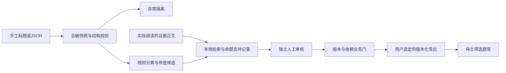

# 项目设计与实现边界

版本：0.1.0；更新日期：2026-10-29。本文描述公开仓库的实际实现；后续设计不等于已完成功能。

## 目标与模块关系

从人工取得的热点线索中研究历史切口，保留可以检查的证据与审核记录，再形成待立项选题包。采集忠实、现代事件确认、实体匹配、史料支持、历史关联和故事适配是不同层次，不能互相代替。

同一进程提供本地HTTP界面或CLI。SQLite采用短事务，跨进程写入由POSIX文件锁串行化。没有后台采集调度器、模型执行器或发布路径。

## 代码职责

| 文件 | 职责 |
| --- | --- |
| `acquisition.py` | 手工适配、确定性字段映射、分类、快照回放、新鲜度与趋势辅助规则 |
| `store.py` | 不可变文档版本、SQLite、事件、归档文件、撤回、备份恢复 |
| `review.py` | 候选修订、证据归档与搜索、审核输入、独立审核与业务门 |
| `exporter.py` | 自包含导出、幂等导入回执、文件检查、待复审通知 |
| `benchmark.py` | 人工金标的完整范围计量和三次独立报告 |
| `service.py` | 统一操作分派、写锁和视图状态 |
| `server.py` / `static/` | 仅回环监听的HTTP接口及四个工作视图 |
| `__main__.py` | CLI、服务启动和错误退出状态 |
| `schemas/` / `examples/` | V1数据契约与明确标记的构造示例 |

## 数据契约与可信边界

快照保存原始标题和另存的规范化标题；ID按字符串保存。热度原值、数值、指标、单位和近似性质分离，仅已明确口径的热度指数进行确定性单位换算。来源时间不使用本地采集时间填补。手工数据的榜单类型固定为manual，不通过输入文案变为平台榜单。

结构检查通过只表示JSON满足约束。程序另查引用存在、环境标记、文件哈希、来源版本、实体状态、主张支持与独立审核。手工输入只证明用户录入内容，不证明其上榜或现代事件真实。

证据来源与支持判断分离：每条evidence_link对应一个evidence_id和claim_id，保留核对位置、摘录、支持/部分支持/反驳结论、核对人和时间。归档正文必须包含摘录；这项检查不能证明上下文或语义判断正确，仍需实际人工核验。

来源家族由记录者填写；本版不自动识别跨站转载。实体由人工消歧，不因同名、同姓或谐音自动合并。规则标签与原始分类、AI标签分存，AI标签当前为空。

## 审核与状态

候选内容版本不可覆盖，修订必须递增。导入文件自带的review、export及通过状态被清空，不能直接获得批准。候选和作者在同一事务保存。

审核输入包括候选版本、桥接命题、实体、快照、归档证据版本、规则版本和项目时长配置哈希；排除review、export、展示状态和作者编辑评分。审核者记录与作者分离，必须声明实际核对并覆盖所有关键主张。身份是本地记录，不构成多人认证。

状态由业务层动态计算，存储的原始候选保持导入时状态。缺资料为evidence_pending；当前版本有审核但输入变化时为needs_recheck；满足全部门槛为approved。导出包在实际写入后带exported及回执。审核决策hold/rejected会阻断导出，但当前视图没有单独显示这两种决策状态。

P0或事实问题须修复并复审；任一最新候选留有未复审P0会暂停该环境推荐/导出。P1/P2采用保守门槛，未实现豁免快捷通道。同一问题两轮未通过提示人工处理；程序没有自动返修生成循环。

## 存储、导出与恢复

项目内路径为`01_选题库/热点中心/{production,test}`，内设原始快照、规范化数据、历史关联候选、审核推荐、选题导出、运行质量六类目录。SQLite实际存放版本化文档与事件，一些目录为后续导出预留；不会假装每类都有文件输出。

归档以确定性JSON序列化后的SHA-256寻址，不会覆盖哈希不一致的已有文件。快照与证据归档可能先于数据库写入；崩溃时允许留下未引用归档，不把它视为已成功导入。

导出业务键：candidate_id＋candidate_version＋目标工作流。检查生产非fixture、现行引用和审核、问题、时效及用户选择范围。先将自包含文件包写入临时目录后重命名，再写回执；若中断发生在文件完成但回执未提交时，重试校验并复用原包。已有内容损坏会报错，不静默修复。

导出目标为同项目`01_选题库/热点导入库`。不自动建立剧集，不改动已有锁稿。后续依赖变更会使业务门拒绝旧审核；audit为受影响的已导出包写复审通知，需要下游消费通知，当前不会自动修改下游制作任务。

备份在写锁下复制归档并通过SQLite backup API保存数据库，附文件清单和哈希。恢复逐文件检查，目标必须是新目录。哈希用于意外修改检测，不是对抗本机恶意篡改者的数字签名。

## 实现状态与路线

| 阶段 | 目前可用 | 后续验收 |
| --- | --- | --- |
| M0 工程 | 独立运行、可指定原工作流数据目录 | 来源使用依据与权限登记 |
| M1 数据 | 手工导入、隔离、回放、规则处理 | 实际授权来源、限速重试、429与缓存回退 |
| M2 研究 | 人工实体/命题/反证、本地检索 | 模型切口、远程检索、自动实体辅助 |
| M3 质量 | 独立审核门、问题记录、基准计算器 | 40开发/60锁定人工金标及三次真实评测 |
| M4 交接 | 版本包与幂等待立项库 | 真实选题到既有建集流程的集成验证 |
| M5 试运行 | 构造回归、完整性、备份恢复 | 前30张推荐人工核验与持续抽检 |

生产展示最多5张通过卡，每个热点通过创建入口最多3个切口。基准计量不使用展示截断，须覆盖全部锁定ID。模型和自动来源未配置时明确返回未配置，绝不以构造示例替代实时结果。
